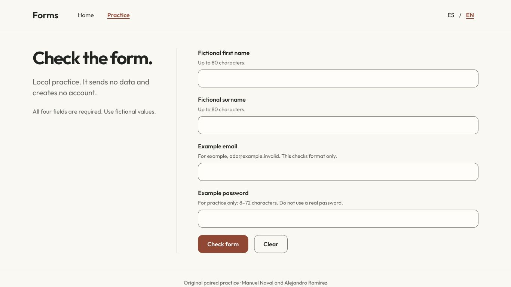
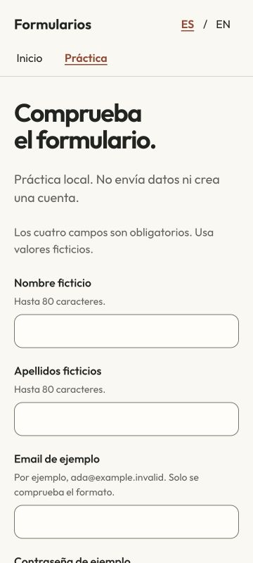
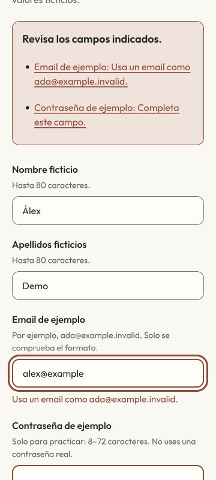

# Práctica de formularios en pareja

[English](README.md) · [Diseño](DESIGN.md) · [Comprobaciones ejecutadas](docs/verification.json)

Ejercicio histórico HTML en pareja, revisado como práctica local de formularios. Sus autores originales son **Manuel Naval y Alejandro Ramírez**. Esta revisión añade navegación clara, validación, recursos ES/EN y recuperación accesible, conservando créditos e historial.



La práctica no envía los valores ni crea una cuenta. El antiguo `POST /registro` no tenía backend; se sustituye por una comprobación explícita en el navegador. Nombre, apellidos, email y contraseña son ejemplos ficticios.

## Ejecutar localmente

Desde este repositorio, sirve los archivos estáticos con Python 3:

```sh
python3 -m http.server 8080 --bind 127.0.0.1
```

Abre `http://127.0.0.1:8080/index.html` para español o `index.en.html` para inglés. Se mantiene la entrada `register.html` y se añade `register.en.html`. Usa HTTP en lugar de abrir archivos directamente para cargar los módulos ES. No hace falta instalar paquetes o un backend.

La portada y los enlaces de navegación/idioma funcionan sin scripts. Los campos permanecen deshabilitados hasta instalar sus handlers; si JavaScript no está disponible, queda visible la explicación.

## Recorridos

- Enviar vacío: el resumen recibe foco, enlaza a cada campo y los errores quedan asociados con sus ayudas.
- Corregir un campo o cambiar ES/EN: los valores permanecen en el formulario y los mensajes se traducen.
- Comprobar un ejemplo ficticio válido con Enter: aparece el resultado local y se borra la contraseña de ejemplo.
- Limpiar: restablece valores/errores y devuelve el foco al primer campo.

Nombres de hasta 80 unidades UTF-16, email de hasta 254 y contraseña de ejemplo de 8–72. Se rechazan controles y campos obligatorios vacíos. El email comprueba formatos comunes ASCII de buzón/dominio; no verifica entrega, identidad o todas las direcciones admitidas por RFC. La longitud de contraseña es una restricción didáctica, no una política de autenticación de producción.




## Implementación y comprobaciones

`copy.mjs` contiene ES y fallback EN. `build.mjs` genera las cuatro páginas HTML incluidas; `app.mjs` gestiona el estado DOM y `validation.mjs` la validación pura. Sin framework, CDN o dependencia de runtime. Outfit local conserva su [aviso OFL completo](fonts/OFL.txt).

Para editar y probar, usa Node.js 22 (comprobado con 22.22.3):

```sh
node build.mjs
node build.mjs --check
node --test tests/validation.test.mjs
```

Pasan trece tests locales. Los recorridos de navegador cubren portátil, móvil de 360 píxeles, horizontal, teclado, errores, corrección, idioma, reset y copia controlada sin el elemento script. Los diez assets servidos coinciden con la fuente. No se añade CI alojada, despliegue Pages o afirmación de lector de pantalla/dispositivo físico.

El formulario cancela submit antes de validar, no tiene nombres de input serializables y fija CSP `form-action 'none'` / `connect-src 'none'`. Los valores solo permanecen en la página: no hay código de storage, cookies, fetch o beacon. El recorrido observado no añadió peticiones HTTP. Los textos dinámicos usan `textContent`, sin interpolar los valores en HTML. Es una práctica, sin servicio de cuentas.

## Alcance y créditos originales

La imagen y el texto originales se conservan como archivos históricos y no se cargan en la UI. No se inventa su procedencia/licencia ni se cambia la del código anterior. [Detalle de componentes](THIRD_PARTY.md).

<details>
<summary>Original documentation and credits · Documentación y créditos originales</summary>

# pmdm-pareja
## Manuel, Naval Rodríguez.
## Alejandro, Ramírez Ramos.
---
Repositorio dedicado a hacer ejercicios de práctica en pareja. 

</details>

[Más proyectos de ingeniería móvil](https://github.com/navalcode)
